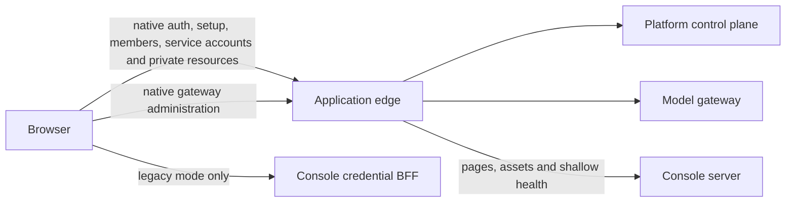

# managed-agent-console

The web console for [managed-agent-platform](https://github.com/OpenSDLC-Dev/managed-agent-platform) — an open-source, self-hostable platform for long-horizon AI agents, wire-compatible with Anthropic's Claude Managed Agents API.

This console is the operator-facing frontend for a platform deployment you run yourself: create and manage **agents** (rendered form or raw JSON↔YAML editor), **environments**, and **sessions** — including live event traces over SSE and human-in-the-loop tool approval — plus **vaults**, **skills**, **files**, and the credentials that let a self-hosted worker connect. Its UI is modeled on the Managed Agents section of Anthropic's Claude Console; its feature scope follows what the platform actually implements.

**Status: v0.8.2 — the v1 feature set is complete.** Changes are in [CHANGELOG.md](./CHANGELOG.md); active work is in [STATE.md](./STATE.md) and the [issue tracker](https://github.com/OpenSDLC-Dev/managed-agent-console/issues).

## Authentication modes

The same production build selects its mode at runtime. The management key never reaches browser JavaScript.

### Native platform login (unreleased)

Set `CONSOLE_AUTH_MODE=platform` behind the platform's one-origin application edge.
The platform owns the HttpOnly cookie, current role, CSRF checks and sign-in method.
The console needs no `PLATFORM_API_KEY`, `CONSOLE_PASSWORD` or console-local OIDC settings in this mode.
It refuses local credential routes and BFF calls rather than falling back to an old key.



Password accounts are for development and test. OIDC and trusted-proxy sign-in use the platform's configured provider.
`/setup` offers code redemption; the platform decides eligibility. Administrators can manage members and service accounts.
A signed-in `user` has no resource reads. Its account, setup and sign-out controls remain available.
Service-account creation does not issue a key. Key ownership and other later plan-69 slices are not implemented here.

Shallow `/api/health` remains console-owned. Native deep health reports `checked:false` with status 503;
it cannot check a person's resource access without their cookie and never spends a leftover key.
The application edge must route native API calls to their owner, not to the console's legacy BFF.

**Release hold:** do not cut a SemVer release until platform plan 69 slice 7.
The non-release SHA image procedure is in [docs/releasing.md](./docs/releasing.md#non-release-sha-channel).
No native-compatible published image is claimed by these source changes.

### Legacy deployments (default)

With `CONSOLE_AUTH_MODE` unset, calls and SSE go through the console's thin server-side proxy.
The two credentials below are never sent together:

- **No identity configured** — the server attaches the management key (`PLATFORM_API_KEY`). A shared-password gate (`CONSOLE_PASSWORD`) is built in; unset, the console is open, which is fine for `localhost` and for nothing else, since anyone who reaches an ungated console can drive the platform with a full-power key. **Something must stand in front of the console on any deployment reachable by anyone else**, and this gate is the option that needs no infrastructure.
- **Identity configured** — the console signs the operator in against the deployment's provider and forwards **their own token**, never the management key ([docs/plan/08](./docs/plan/08_console-sso-rbac.md)). Without a session it fails closed. `PLATFORM_API_KEY` stays only as the deep health check's service credential, which no browser request can spend.

| Variable            | Required | Meaning                                                |
| ------------------- | -------- | ------------------------------------------------------ |
| `PLATFORM_BASE_URL` | yes      | Control-plane base URL, e.g. `http://localhost:8080`   |
| `PLATFORM_API_KEY`  | yes\*\*  | The platform's management key (`CONTROLPLANE_API_KEY`) |
| `CONSOLE_PASSWORD`  | no\*     | Enables the login gate when set; unset ⇒ no gate       |

\* Optional only on `localhost`, or where something else authenticates in front of the console — as
on the GKE deployment below. Otherwise mandatory. \*\* Required unless identity is configured, where
browser calls carry the operator's token and the key serves only the deep health check.

## Quickstart (Docker)

```bash
docker run --rm -p 3000:3000 \
  -e PLATFORM_BASE_URL=http://host.docker.internal:8080 \
  -e PLATFORM_API_KEY=your-controlplane-api-key \
  -e CONSOLE_PASSWORD=choose-a-password \
  ghcr.io/opensdlc-dev/managed-agent-console:0.8.2
```

Then open http://localhost:3000. Images are multi-arch (`linux/amd64`, `linux/arm64`); pin a version as above, `latest` follows the newest release. Building from a checkout works too — `docker build -t managed-agent-console .` — and is what CI gates on every PR.

### Next to the platform's compose stack

Join the platform's network and talk to the `controlplane` service directly:

```yaml
console:
  image: ghcr.io/opensdlc-dev/managed-agent-console:0.8.2
  ports:
    - "127.0.0.1:3000:3000"
  environment:
    PLATFORM_BASE_URL: http://controlplane:8080
    PLATFORM_API_KEY: ${CONTROLPLANE_API_KEY:?set CONTROLPLANE_API_KEY in .env}
    CONSOLE_PASSWORD: ${CONSOLE_PASSWORD:-}
  depends_on:
    - controlplane
```

Or with `docker run --network managed-agent-platform_default` and the same three variables.

## Deploying to a cluster

[deploy/k8s/](./deploy/k8s/) holds what the console needs beside a platform running in Kubernetes, and [docs/deploy-gcp.md](./docs/deploy-gcp.md) describes the pipeline that applies them — build → push → deploy → smoke, on every push to `main`, with no long-lived credential in this repository.

That deployment publishes the console on the public internet behind **Google sign-in restricted to one Workspace domain, enforced at the load balancer by GCP IAP**, so the pod runs with no `CONSOLE_PASSWORD` and no authentication code at all. None of that is baked into the published image, which behaves identically wherever it runs.

## Development

```bash
pnpm install
cp .env.example .env.local   # fill in PLATFORM_BASE_URL / PLATFORM_API_KEY
pnpm dev                     # console on http://localhost:3000
```

Checks — the default suites spend no money and need no network:

```bash
pnpm test       # Vitest unit/component tests
pnpm test:e2e   # Playwright against the in-repo mock platform server
pnpm lint       # eslint; pnpm typecheck and pnpm format:check also exist
```

To verify the current GA Skills contract against a local platform without model
calls, configure `.env.local` and run
`RUN_LIVE_CONTRACT_TESTS=1 pnpm test:contract:live` (PowerShell:
`$env:RUN_LIVE_CONTRACT_TESTS='1'; pnpm test:contract:live`). This creates and
removes a dedicated test skill; it fails on missing configuration or an old wire
shape. It does not replace the model-backed live session suite.

Outcome and deployment contracts enqueue model turns even with a `self_hosted`
environment and no worker. They require the additional opt-in
`RUN_LIVE_MODEL_CONTRACT_TESTS=1` alongside `RUN_LIVE_CONTRACT_TESTS=1` (PowerShell:
`$env:RUN_LIVE_MODEL_CONTRACT_TESTS='1'`) and may spend real model tokens.
Set the opt-in flags in the invoking shell; dotenv files cannot grant consent.
Add `--project=model-backed` to `pnpm test:contract:live` to run only those tests.

The model-free native browser tier builds production code and starts its own PostgreSQL, real platform handlers,
local test identity provider and application edge. It reads no credential files and runs no brain or vendor calls:

```bash
NATIVE_PLATFORM_SOURCE=/absolute/path/to/managed-agent-platform \
NATIVE_EVIDENCE_DIR=/absolute/path/to/scratch \
pnpm test:e2e:native
```

The platform source must implement plan 69 slice 2. The tier needs Docker and that checkout's Go toolchain.
It creates durable receipts before starting its container, then awaits shutdown and removes only its own container and volumes.
Use `NATIVE_FIDELITY=1` with the same command to walk the native manifest in installed Chrome, light and dark.
Those shots are local fidelity evidence, not proof of access to authenticated reference screens.

The live tier drives a **real platform stack** (the platform repo's `deploy/compose`) and spends real
model tokens:

```bash
RUN_LIVE_CONSOLE_TESTS=1 pnpm test:e2e:live
```

Once opted in, missing configuration **fails** rather than skips. It creates `live-e2e-`-prefixed resources, archives its agents on the way out, and runs exactly one model-driven session.

## Contributing

Read [CLAUDE.md](./CLAUDE.md) first — the design principles (notably: the platform's implemented API is the single source of truth, never guess at wire shapes) and the PR-based workflow. Why the repo is shaped as it is: [docs/HISTORY.md](./docs/HISTORY.md).

## License

[Apache-2.0](./LICENSE)
