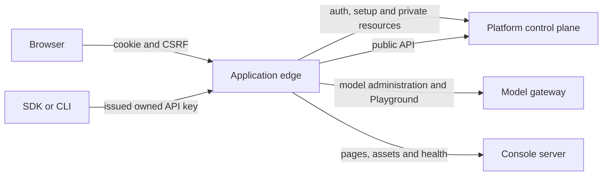

# managed-agent-console

The web console for [managed-agent-platform](https://github.com/OpenSDLC-Dev/managed-agent-platform) — an open-source, self-hostable platform for long-horizon AI agents, wire-compatible with Anthropic's Claude Managed Agents API.

This console is the operator-facing frontend for a platform deployment you run yourself: create and manage **agents** (rendered form or raw JSON↔YAML editor), **environments**, and **sessions** — including live event traces over SSE and human-in-the-loop tool approval — plus **vaults**, **skills**, **files**, and the credentials that let a self-hosted worker connect. Its UI is modeled on the Managed Agents section of Anthropic's Claude Console; its feature scope follows what the platform actually implements.

**Status: v0.9.1 — the v1 feature set is complete.** Changes are in [CHANGELOG.md](./CHANGELOG.md); active work is in [STATE.md](./STATE.md) and the [issue tracker](https://github.com/OpenSDLC-Dev/managed-agent-console/issues).

## Platform login

The platform owns login, the HttpOnly session cookie, current roles and CSRF checks.
Serve this Console behind the platform's one-origin application edge. Next.js serves pages, assets and shallow health only.
It holds no management key, login password or OIDC client secret.



Password accounts are for development and test. OIDC and trusted-proxy sign-in use the platform's configured provider.
`/setup` offers code redemption; the platform decides eligibility. Administrators manage members and service accounts.
An administrator can enable Playground for a `user` in Members. The member keeps account, setup and sign-out controls.
Developers issue and manage their own API keys. Administrators can also issue keys for active service accounts.
Each key uses its owner's current role; deactivating the owner revokes access.
Browser calls keep using the session cookie, never a revealed key.

Administrators manage every environment's keys, including cloud and archived environments.
Cloud keys cannot poll for work. Removing the issuer does not revoke an environment key; revoke the key itself.
Administrators can assign an active service account to initiate future scheduled deployment runs.
This neither resumes a paused deployment nor changes a manual run's caller.
Model inference uses the owner's current role and organization limits shared by public model alias.

Shallow `/api/health` remains Console-owned. Deep health reports `checked:false` with status 503;
it cannot check a person's resource access without their cookie and never spends a service credential.

**Upgrade boundary:** this source requires the platform's native login and application edge from plan 69 slice 6 or later.
See [the upgrade procedure](./docs/deploy-gcp.md#upgrade-boundary) before replacing a legacy installation.
The [SHA image channel](./docs/releasing.md#non-release-sha-channel) publishes images for staging.

## Running the Console

Use the [platform Compose stack](https://github.com/OpenSDLC-Dev/managed-agent-platform/tree/main/deploy/compose) for local setup.
It includes the Console and the application edge at `http://localhost:3000`.
Retrieve the restricted first-admin code using that stack's instructions, open `/setup`, and issue a key through API Keys.
Use that issued key for SDK or CLI access. The browser needs no key configuration.

To build a candidate image from this checkout:

```bash
pnpm image:build
```

Select that image for the platform's Console service. Keep the application edge in front of it;
exposing the Next.js container alone does not provide platform APIs or login.
The account menu reads the running Platform build from the signed-in session. An open Console picks up upgrades automatically. Older Platform builds that omit the version display “Platform version unavailable”. Both products use the [build version format](docs/releasing.md#build-versions).
Published images support `linux/amd64` and `linux/arm64`. Pin the verified image digest for deployments.

## Deploying to a cluster

The [platform chart and deployment](https://github.com/OpenSDLC-Dev/managed-agent-platform/tree/main/deploy/gcp)
own the Console, application edge, login configuration and rollout checks.
This repository publishes Console images. It no longer deploys a separate credential proxy or IAP backend.
[docs/deploy-gcp.md](./docs/deploy-gcp.md) describes the ownership and upgrade boundary.

## Development

```bash
pnpm install
pnpm dev                     # page server on http://localhost:3000
```

For manual development, route the application edge's page backend to this server while keeping its API routes on the platform.
Direct page-server access cannot sign in. `.env.example` documents optional test inputs, not Console deployment credentials.

Checks — the default suites make no vendor API calls:

```bash
pnpm test       # Vitest unit/component tests
pnpm test:e2e   # Playwright against the in-repo mock platform server
pnpm lint       # eslint; pnpm typecheck and pnpm format:check also exist
```

To verify the current GA Skills contract against a local platform without model
calls, configure `.env.local` and run
`RUN_LIVE_CONTRACT_TESTS=1 pnpm test:contract:live` (PowerShell:
`$env:RUN_LIVE_CONTRACT_TESTS='1'; pnpm test:contract:live`). This creates and
removes a dedicated test skill; it fails on missing configuration or an old wire
shape. It does not replace the model-backed live session suite.

Outcome and deployment contracts enqueue model turns even with a `self_hosted`
environment and no worker. They require the additional opt-in
`RUN_LIVE_MODEL_CONTRACT_TESTS=1` alongside `RUN_LIVE_CONTRACT_TESTS=1` (PowerShell:
`$env:RUN_LIVE_MODEL_CONTRACT_TESTS='1'`) and may spend real model tokens.
Set the opt-in flags in the invoking shell; dotenv files cannot grant consent.
Add `--project=model-backed` to `pnpm test:contract:live` to run only those tests.

The model-free native browser tier builds production code and starts its own PostgreSQL, real platform handlers,
local test identity provider and application edge. It reads no deployment credential files and runs no brain or vendor calls:

```bash
NATIVE_PLATFORM_SOURCE=/absolute/path/to/managed-agent-platform \
NATIVE_EVIDENCE_DIR=/absolute/path/to/scratch \
pnpm test:e2e:native
```

The platform source must implement the private Playground API from plan 73 and the native browser APIs from plan 69. The tier needs Docker and that checkout's Go toolchain.
A test-only client builds against the platform's pinned Go SDK. Human and service-account keys come from the browser's one-time reveal, then reach the client through stdin.
Independent cookie reads check persisted Memory actors, redacted nulls and current authority. No `ant` checkout is needed by this automated tier.
The separate real-`ant` check must run against a fresh packaged Compose install after immutable source/image pairing.
Native fixtures and a local candidate image do not satisfy that deployment check; the [platform state](https://github.com/OpenSDLC-Dev/managed-agent-platform/blob/main/STATE.md) tracks it.
It accepts only a local Unix Docker endpoint and refuses to start beside platform test-fixture containers.
A nonempty `DOCKER_CONFIG` must be an absolute path; the runtime refuses relative paths before any Docker command.
The runtime checks its effective child environment, retains the Docker selectors and disables Next telemetry before starting resources.
It creates durable receipts before starting its container, then awaits shutdown and removes only its own container and volumes.
Use `NATIVE_FIDELITY=1` with the same command to walk the native manifest in installed Chrome, light and dark.
Those shots are local fidelity evidence, not proof of access to authenticated reference screens.
Native specs must import [the guarded test fixture](./test/native/test.ts); its pinned runner hooks redact issued-key errors before output.
Both native modes run synthetic unexpected-failure controls, including a first-write observer. Never log credentials or attach them explicitly; reveal screenshots must stay masked.

The live tier drives a **real platform stack** (the platform repo's `deploy/compose`) and spends real
model tokens:

```bash
RUN_LIVE_CONSOLE_TESTS=1 pnpm test:e2e:live
```

Once opted in, missing configuration **fails** rather than skips. It creates `live-e2e-`-prefixed resources, archives its agents on the way out, and runs exactly one model-driven session. The live tier disables automatic browser captures and Playwright debug logging because it uses real credentials.

## Contributing

Read [CLAUDE.md](./CLAUDE.md) first — the design principles (notably: the platform's implemented API is the single source of truth, never guess at wire shapes) and the PR-based workflow. Why the repo is shaped as it is: [docs/HISTORY.md](./docs/HISTORY.md).

## License

[Apache-2.0](./LICENSE)
